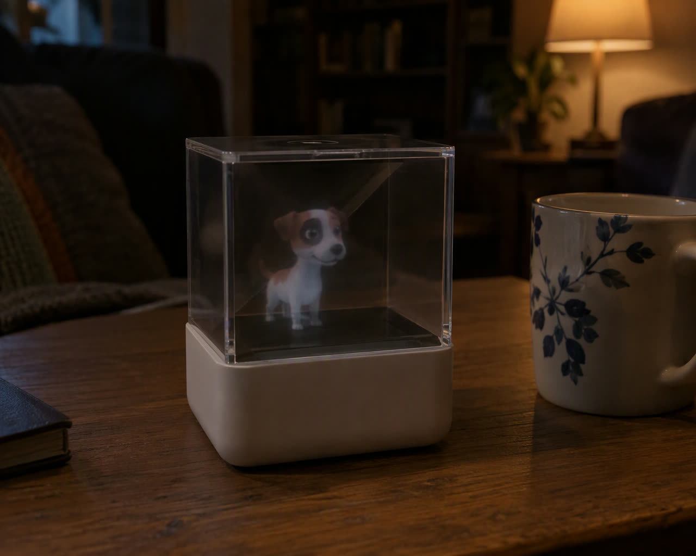
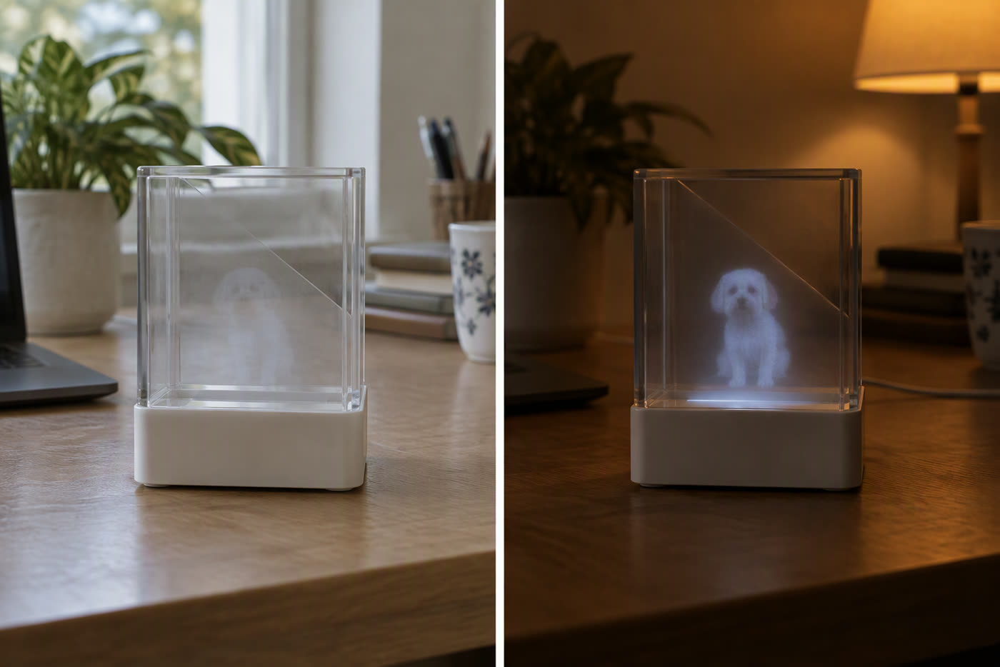
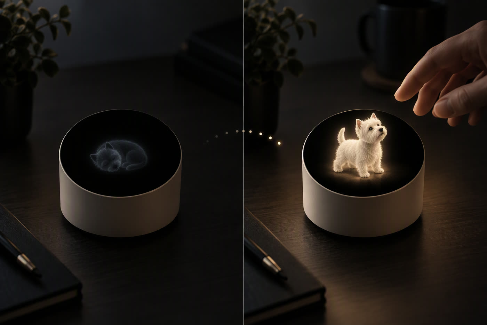
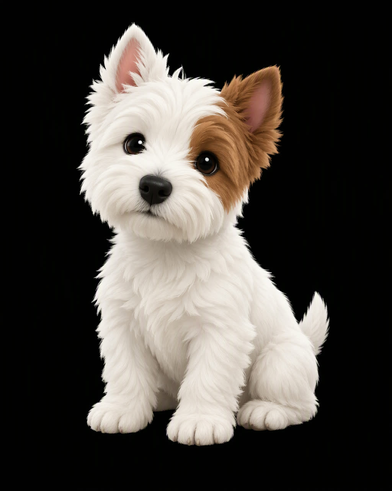

# 灯下 · afterimage

> 只在晚上醒着的一团光。
>
> *A small dog that lives in a box on your desk. It only wakes up when you come near.*

「灯下」是一个手掌大的桌面装置。屏幕平放在盒底，一片 45° 的膜把它反射成竖在盒子里的一团光——不是全息，我们也不假装是。它白天几乎不亮，只在晚上、在你坐下的那一刻醒过来。我们想放进去的不是一张照片，是你家那只：它耳朵上那块棕斑，它歪头的方向。

*右边那只杯子是比例尺。整台机器就是手掌大小，虚像高约 4.3 厘米。*

---

## 先说清楚：它不是全息

市面上几乎所有写着"全息"的桌面产品，用的都是三百年前的一个戏法：把一块屏幕平放，在上面斜插一片半反膜，于是屏幕上那只狗被反射成**竖在盒子里的一团光**。你的眼睛被骗了，但物理上没有骗——那确实只是光。

我们也不打算骗你。这台机器用的就是这个戏法，一块 ESP32-S3 驱动的 2.06 吋小屏，一片几十块钱的膜。

**我们感兴趣的是另一件事：既然它只是一团光，那这团光在等什么。**

## 它只在晚上成立

这是这个项目最重要的一张图，也是我们最早学会的一件事。

左边是白天，靠窗的普通书桌。那只狗几乎不存在——你会以为盒子是空的。右边是关了顶灯、只留一盏台灯的同一张桌子，它突然就在那儿了。

原因不复杂：虚像的亮度是**屏幕亮度乘以膜的反射率**，大概一百多尼特——听起来不少，但白天的窗户有几千尼特，直接透过膜糊在你眼睛上。**它不是被照亮了，是被盖住了。**

我们本来可以想办法把它做亮，但那要换更贵的屏、更耗电、还更容易烧屏。我们选了另一条路：**承认它属于晚上。**

于是它变成了一个会睡的东西。

## 它会等你

白天它几乎不亮，只留一团快要看不见的呼吸。到了晚上，当你坐到桌前——盒子里那颗毫米波雷达感觉到你了——它抬头，看你，醒过来。你拍一下桌子，它抖一下。你走开，它又睡回去。

这是这台机器和"全息相框"这四个字唯一真正的区别。

市面上已有的同类产品，本质上是**让你的手机屏幕朝下扣在一个盒子上放视频**。它的盒子是死的，所有事情都发生在那部手机上：手机响了、没电了、被人拿走了，装置当场不存在。而它嘴里那句"感知到你靠近"，只能是文案。

我们想做的恰恰相反：**盒子是活的，手机根本不在场。** 它有自己的电源、自己的传感器、自己的判断。它不需要你打开任何 App，也不需要你想起它。它只是在你坐下的那一刻醒过来。

## 它靠什么认出那是你家那只

4.3 厘米高、几百像素宽的一团光，画不出毛发。这一点我们试过，也认了。

但人认自己的狗，从来不靠毛发。**靠的是那块棕斑压在左耳上、耳朵是立着还是塌着、坐着的时候脖子往哪边歪。** 所以我们的画面语言是剪影、花色和姿态，不是画质——背景必须是纯黑（AMOLED 的黑是像素真的关掉，所以那块"底"会彻底消失），主体只占画面七成，动作必须慢。

也就是说，你给它一张照片，它交付的不是一张会发光的照片，**是一个"它一眼就知道是它"的东西**。这件事比显示技术难，也比显示技术值钱。

## 我们还没做到的事

这个仓库现在是一个**探索中的原型**，不是一件商品。以下这些我们**没有证明**，别当成已完成：

- **认得出吗。** 一张真实照片缩到 410×502、放在 4.3 厘米的物理尺寸上，人能不能三秒内认出"是我家那只"——还没测。这是整个项目的生死题，排在所有事前面。
- **动起来会不会崩。** 转头时耳朵和花色的位置关系会不会散架，还没测。如果会崩，那它只能呼吸，不能回头。
- **白天可用。** 做不到，也不打算做到。
- **更大。** 虚像尺寸等于屏幕尺寸，这块板子的天花板就是 4.3 厘米。想要十厘米，得换掉整个芯片方案。
- **烧屏。** AMOLED 长时间挂静态图会留影。它现在靠"大部分像素不亮 + 只在有人时醒"来躲，但躲不躲得掉，要看长期。

## 为什么做这个

因为有一件很小、但一直没人管的事：**你想起它的时候，手上没有一个动作可以做。**

想念是不需要流量的，也不需要打开哪个 App。它需要的是一小块地方，一个会等你的东西，一盏台灯下刚好看得见的亮度。

现有的解决方案要么是手机里的一张照片（你不敢常翻，翻一次疼一次），要么是一个昂贵的、写着"全息"的柜子。**中间那一格是空的：一个不说话的、手掌大的、晚上才醒的东西。**

我们想把那一格填上。

---

**名字。** 中文叫「灯下」——它只在台灯下成立。英文 **afterimage**：光学上的残影，也是一个人走后留下来的那个样子。我们不做复活，我们做的是余像。

**欢迎做的事**：给我们一张你家里那只（人或动物）的照片，告诉我们"这个尺寸下你还认不认得出它"——这一条反馈现在比任何代码都有用。

**许可证**：待定，在正式定下来之前默认保留所有权利。想复用请先开一个 issue。
